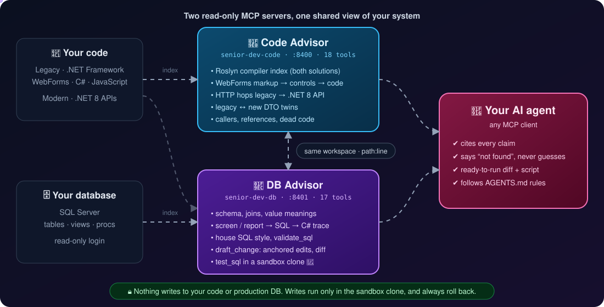
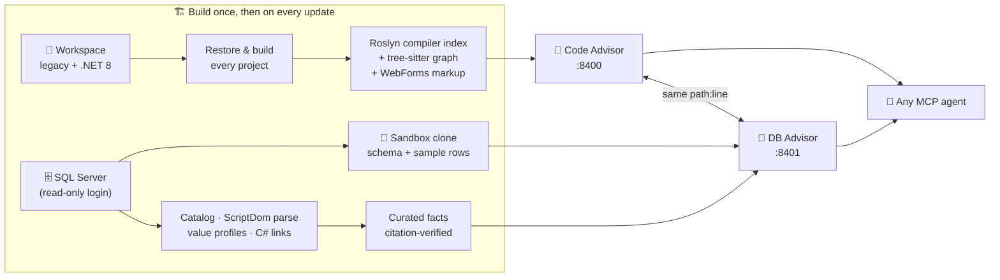

<p align="center">
  
</p>

<p align="center">
  
  
  
  
  
  
  
</p>

<h3 align="center">Your AI agent is smart. It just has never seen <i>your</i> system.<br>Senior-Dev-MCP gives it the knowledge of a developer who has worked on your code and your database for years.</h3>

<p align="center">
  <a href="#-see-it-work">See it work</a> •
  <a href="#-how-it-works">How it works</a> •
  <a href="#-35-tools">Tools</a> •
  <a href="#-safe-by-design">Safety</a> •
  <a href="#-tailored-to-your-system">Tailored to you</a> •
  <a href="#-work-with-us">Work with us</a>
</p>

---

## 😩 The problem

Every company with a long-lived .NET product knows this story:

- 🏚️ **A legacy WebForms app** with a decade of business rules nobody fully remembers, half-migrated to **.NET 8 APIs**.
- 🗄️ **A SQL Server database** with hundreds of tables and procedures, where `Status = 3` means something only one person knows.
- 🤖 **AI coding agents** that are brilliant in general and **confidently wrong** about your system: they guess table meanings, invent methods, and write SQL that compiles nowhere.
- ⏳ **Senior developers** who spend their days answering "where is this computed?" instead of building.

> The agent isn't the problem. **Context** is.

## ✨ The solution

**Senior-Dev-MCP** is a pair of **read-only [MCP](https://modelcontextprotocol.io) servers** that sit next to your codebase and your database and answer an agent's questions **with evidence**:

| | 🧠 **Code Advisor** | 🧬 **DB Advisor** |
|---|---|---|
| Knows | your C#, ASP.NET WebForms and JavaScript, legacy **and** .NET 8 | your SQL Server schema, data meanings, views and procedures |
| Powered by | the **Roslyn compiler** + a tree-sitter graph + WebForms markup analysis | the SQL catalog + **ScriptDom** parsing + value profiles + curated facts |
| Answers | *who calls this? where is this caption filled? which API does this page hit?* | *what does `Status = 3` mean? which SQL does this report run? is my change safe?* |
| Every answer | 📌 cites `File.cs::Class.Member` | 📌 cites `dbo.Object:line` or `Table.Column` |

Both index **the same workspace**, so a C# line cited by the DB Advisor opens at the same line in the Code Advisor. The agent gets **one consistent picture of your whole system**.

## 🎬 See it work

A (fictional) ticket, solved end to end by an agent connected to both servers:

<p align="center">
  
</p>

What just happened:

1. 🔎 **Traced** the report from its title to the stored procedure behind it, on every code side that registers it.
2. 🧩 **Decoded** the column: two similar columns, two currencies, one right answer.
3. 🧠 **Read the C#** the invoice screen runs, with a compiler-exact citation.
4. ✍️ **Drafted** the fix as anchored edits on the live procedure text, never retyped from memory.
5. ✅ **Validated** it: compiles, follows *your team's* SQL style.
6. 🧪 **Tested it for real** in a sandbox clone, seeded with the exact rows from production, then **rolled back**.

The developer gets a diff, a full script, the evidence and the test result. **Nothing was written to production.**

## 🧠 How it works

<p align="center">
  
</p>



Under the hood:

- ⚙️ **Compiler-grade answers.** The workspace is restored and built project by project, then indexed by Roslyn on **both** .NET Framework and .NET 8. Even WebForms pages, which have no designer files, get their ASP.NET-generated code compiled and mapped back to the exact `.aspx` line.
- 🔗 **Cross-stack links.** Legacy pages calling the new API are matched to the endpoints they hit. Legacy DTOs are paired with their .NET 8 twins, with every field difference listed.
- 🧬 **A database that explains itself.** Every view and procedure is parsed. Columns are linked to the C# that reads and writes them, magic values are decoded from enums and code, and the team's SQL style is learned from recent work.
- 📚 **Curated knowledge, verified.** A model reads the code to explain what columns mean, and **only facts whose citations check out** enter the index.
- 🏷️ **Honest layers.** Every result says how it knows: `roslyn-index` (compiler-exact), `graph` (name-based), `catalog`, `sql-parse`, `live`, `sandbox`, `curated`. `no_results` is a real answer, never a guess.

### 💪 Proven on a real system

Built for, and measured on, a production codebase of:

| | |
|---|---|
| 📄 **~2.1 million lines** | of C#, ASP.NET WebForms and JavaScript |
| 🏗️ **341 projects** | across a .NET Framework solution and a .NET 8 one, most of them in no `.sln` |
| 🔣 **224,000 symbols** | and 2.7 million references indexed; 175,000 declarations resolved by the compiler |
| 🖥️ **450+ WebForms pages** | 10,000+ controls bound to their code |
| 🗄️ **1,150+ SQL modules** | parsed in about 6 seconds |

## 🧰 35 tools

<details>
<summary><b>🧠 Code Advisor: 18 tools</b> for C#, WebForms and JavaScript</summary>

| Tool | What it answers |
|---|---|
| `find_symbol` · `go_to_definition` · `get_type_info` | Where is it declared, and what is it? |
| `find_references` · `find_callers` · `find_implementations` | Who uses it, calls it, implements it? |
| `get_dependency_graph` · `find_dead_code` | What depends on what, and what is never used? |
| `find_control` · `get_control_binding` · `get_page_assets` | Which control shows this caption, and which code fills it? |
| `find_api_calls` | Which .NET 8 endpoints does this page or method reach? |
| `find_migration_twin` | What is the new-stack twin of this legacy DTO, and how do they differ? |
| `read_file_range` · `search_text` | The exact code, by symbol, anchor or `path:line` |
| `get_source_manifest` · `read_source_batch` | Bulk, budgeted, hash-checked source export |
| `index_status` | How fresh is the index, and what can't it see? |

</details>

<details>
<summary><b>🧬 DB Advisor: 17 tools</b> for SQL Server and how the code uses it</summary>

| Tool | What it answers |
|---|---|
| `find_db_object` · `trace_screen` | A name, caption, label or page URL → the SQL objects and C# behind it |
| `describe_table` · `describe_column` · `get_value_map` | What a table holds, what a column means, what each value stands for |
| `get_object_outline` · `get_object_definition` | A procedure's structure, then exactly the lines you need |
| `find_column_usage` · `find_join_path` · `get_impact` | Who reads it, how to join it, what breaks if it changes |
| `get_house_style` · `search_sql` | How *your* team writes SQL, with real examples |
| `validate_sql` · `preview_query` | Does it compile (`NOEXEC`)? What does it return (capped, read-only)? |
| `draft_change` | Anchored edits on the live text → an exact diff and a full script |
| `test_sql` | Runs it **for real** in the sandbox clone, then rolls back |
| `index_status` | Build time, objects changed since, known limits |

</details>

## 🔒 Safe by design

Senior-Dev-MCP is built so that **trusting it is easy**:

- 🚫 **No tool can write.** Each server refuses to start if a tool name contains a mutating verb (`write`, `delete`, `exec`, `drop`, …), and a contract test enforces it.
- 👀 **Production is read-only.** The DB Advisor reads through a read-only login with low row and time limits. `validate_sql` compiles under `SET NOEXEC ON`, so it executes nothing.
- 🧪 **Writes only happen in a sandbox.** `test_sql` runs scripts in a small clone of your database, on a server you own, as a user with no rights outside it, **inside a transaction that always rolls back**. If a script commits on its own, the clone resets from a snapshot.
- 🔑 **No credentials in config.** Logins live in a local `.env` that is never shipped, logged or committed.
- 📌 **Cite it or don't say it.** The agent contract ([`AGENTS.md`](AGENTS.md)) makes every claim traceable, every caveat visible, and every inference labelled as inference.

## 🎯 Tailored to your system

This isn't a SaaS you sign up for. **Every deployment is built around one client's system**, because that's what makes the answers right:

| We adapt | For example |
|---|---|
| 🧱 **Your stack** | WebForms, Web API, .NET Framework → .NET 8 migrations, website projects with no `.csproj` |
| 🗄️ **Your database** | your schema conventions, row kinds, currencies, soft deletes, magic values |
| 📏 **Your rules** | your team's SQL style and task-comment format, built into `validate_sql` |
| 📚 **Your knowledge** | curated, citation-verified facts about what your columns and codes really mean |
| 🖥️ **Your infrastructure** | on-premises, offline-installable package, your network, your agents (Claude Code, Cursor, VS Code, …) |
| 🧪 **Your tickets** | an evaluation set built from your real past tickets, to prove the answers before you rely on them |

## 🗺️ Repository tour

```
Senior-Dev-MCP/
├── 📜 AGENTS.md             the rules an agent follows with both servers
├── 🧠 code_advisor/          the Code Advisor (Python + C# Roslyn host + ASP.NET codegen bridge)
│   ├── src/senior_dev_code/  indexer, compiler index, 18 tools
│   ├── roslyn-host/          C# sidecar: loads both solutions, indexes every symbol
│   └── markup-codegen/       asks ASP.NET for every page's generated code
├── 🧬 db_advisor/            the DB Advisor (Python + C# ScriptDom/Roslyn helpers)
│   ├── src/senior_dev_db/    catalog, parsing, linking, curation, sandbox, 17 tools
│   ├── sql-parser/           T-SQL parser (ScriptDom)
│   ├── code-extractor/       finds every SQL use in the C# code
│   └── knowledge/            team SQL style + curated facts (examples)
├── ⚙️ full_pipeline.ps1      build both, end to end
├── 📦 build_mcp.py           offline deployment package
└── 📖 docs/                  setup runbook, licensing, artwork
```

Each advisor has its own `README.md` (developer guide) and `CLAUDE.md` (architecture). All settings live in one `config.toml` per advisor.

## 🚀 For developers: a quick look

```powershell
.\full_pipeline.ps1                                   # build + index both advisors
code_advisor\scripts\run.ps1                          # serve the Code Advisor on :8400
db_advisor\scripts\run.ps1                            # serve the DB Advisor on :8401
db_advisor\scripts\verify.ps1 -Stage server           # prove both answer, and agree
```

Then point any MCP client at both (see [`.mcp.example.json`](.mcp.example.json)) and drop [`AGENTS.md`](AGENTS.md) into your project. The full runbook is in [`docs/SETUP.md`](docs/SETUP.md).

> ℹ️ This repository is a **showcase** of the system's design and code. A real deployment is configured for a specific codebase and database, so it won't run out of the box against yours. **That's what we're for.**

## 🤝 Work with us

Have a legacy .NET system your team (and your AI tools) struggle to understand? We build Senior-Dev-MCP for your codebase and your database, deploy it in your environment, and prove it on your own tickets.

👉 **Reach out through the contact on the repository owner's GitHub profile.**

## 📜 License

Source-available under the **[Senior-Dev-MCP Monetization-Restricted License 1.0](LICENSE)**: free for personal, educational, research and internal use. Selling it or offering it as a paid service needs a separate commercial license; see [`docs/COMMERCIAL-LICENSING.md`](docs/COMMERCIAL-LICENSING.md).

<p align="center"><sub>Built with ❤️, Roslyn, ScriptDom, tree-sitter and the Model Context Protocol.</sub></p>
